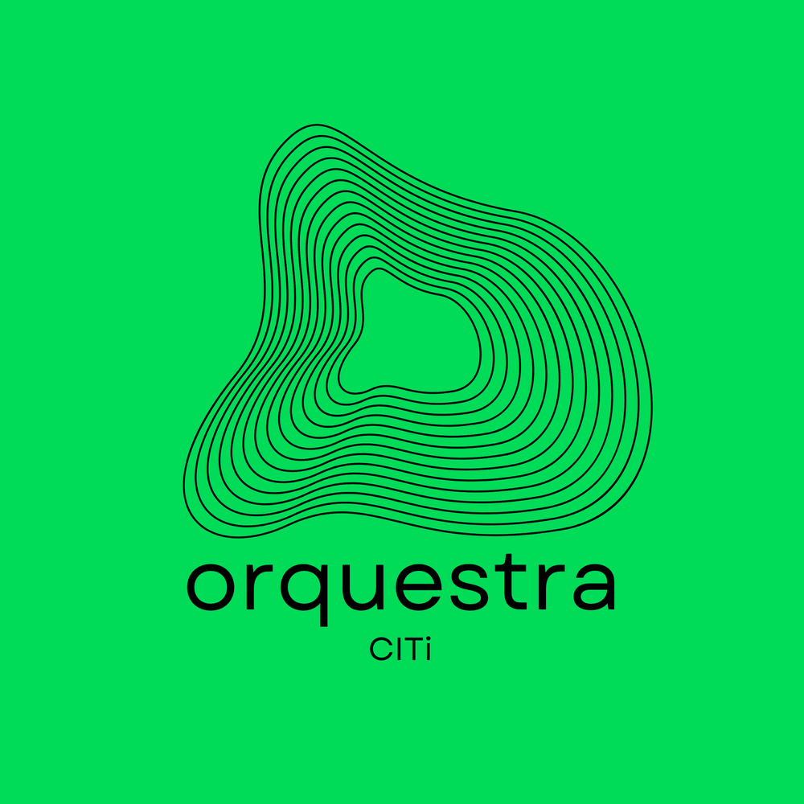

<p align="center">
  
</p>

<h1 align="center">CITi Orquestra</h1>

<p align="center"><b>Monte o squad certo e veja o impacto antes de decidir.</b></p>

Ferramenta interna do CITi que monta **3 squads por projeto** (Segura, Evolutiva e Balanceada) a partir das habilidades e da disponibilidade dos membros, recomenda uma delas conforme a prioridade do gerente e mostra o impacto de cada decisão (trocar uma pessoa, alguém sair) **antes** de ela ser tomada.

**Site no ar:** https://citi-orquestra.onrender.com
**Vídeo de apresentação:** (link do YouTube a preencher)
**Diário de uso de IA:** [AI_LOG.md](AI_LOG.md)

---

## Índice

1. [O problema e a ideia](#o-problema-e-a-ideia)
2. [Funcionalidades](#funcionalidades)
3. [Como a IA é usada](#como-a-ia-é-usada)
4. [Como funciona por dentro](#como-funciona-por-dentro)
5. [Tecnologia](#tecnologia)
6. [Rodar no seu computador](#rodar-no-seu-computador)
7. [Testes](#testes)
8. [Publicação](#publicação)
9. [Estrutura do repositório](#estrutura-do-repositório)
10. [Limites conhecidos e próximos passos](#limites-conhecidos-e-próximos-passos)

---

## O problema e a ideia

Hoje, montar o time de um projeto depende da memória de quem conhece as pessoas. Isso esconde três riscos: uma única pessoa dominando uma habilidade crítica, novatos sem mentor e gente sobrecarregada.

O CITi Orquestra transforma essa decisão em algo visível e comparável. A regra central do projeto:

> **O algoritmo decide; a IA só interpreta e explica.**
> Quem escolhe pessoas, calcula medidores e define níveis é código determinístico e testado. A IA lê texto livre (briefing, entrevista) e **propõe** rascunhos, mas o gerente e o membro sempre revisam e confirmam.

---

## Funcionalidades

| # | Funcionalidade | Em uma frase |
|---|---|---|
| 1 | [3 squads por projeto](#1-três-squads-por-projeto) | Segura, Evolutiva e Balanceada, sempre diferentes entre si |
| 2 | [Medidores](#2-medidores-entrega-crescimento-e-risco) | Entrega, Crescimento e Risco de 0 a 100, com cada fator explicado |
| 3 | [Mentoria](#3-mentoria) | Novatos só entram com mentor, com regras claras de carga |
| 4 | [Detalhes e gráficos](#4-detalhes-da-squad-e-gráficos) | Radar de nível real × exigido, grafo de mentoria, barras de carga |
| 5 | [Trocar uma pessoa](#5-trocar-uma-pessoa-simulação) | Substitutos ordenados por impacto, com variação em tempo real |
| 6 | [Recomendação por prioridade](#6-recomendação-por-prioridade) | "Prazo apertado", "Formar gente" ou "Equilíbrio" destacam uma squad |
| 7 | [Teste de estresse](#7-teste-de-estresse-e-se-alguém-sair) | Mostra quem é o ponto mais frágil da squad |
| 8 | [Briefing com IA](#8-briefing-com-ia) | Cole o texto do cliente e receba papéis, duração e um nome sugerido |
| 9 | [Perfil do membro](#9-perfil-do-membro-formulário-e-entrevista-com-ia) | Formulário guiado ou entrevista com IA, com checagem de coerência |
| 10 | [Importar planilha](#10-importar-planilha-de-membros) | Use os membros reais do seu time em vez dos dados de exemplo |
| 11 | [Projetos prontos](#11-projetos-prontos-e-o-projeto-armadilha) | 6 exemplos, incluindo um "armadilha" que mostra o risco aparecendo |
| 12 | [IA real ou simulada](#12-ia-real-ou-simulada-sempre-visível) | O modo ativo aparece na tela; sem IA, tudo continua funcionando |

### 1. Três squads por projeto

Para cada projeto o sistema monta três opções, comparadas lado a lado numa tabela:

| Tipo | Ideia | Regra sobre novatos |
|---|---|---|
| **Segura** | Maior entrega e menor risco | Nenhum novato |
| **Balanceada** | Meio-termo entre entrega e crescimento | Exatamente 1 novato, com mentor |
| **Evolutiva** | Maior crescimento, aposta em quem está aprendendo | Pelo menos 2 novatos (ou metade dos papéis, se for maior), todos com mentor |

As três têm conjuntos de pessoas diferentes, e a escada é garantida por testes: a **entrega** cai de Segura para Evolutiva e o **crescimento** sobe, sem empate entre os tipos.

### 2. Medidores: Entrega, Crescimento e Risco

- **Entrega (0–100):** cobertura das habilidades exigidas x folga de horas. Quem aprende com mentor ainda rende menos que um veterano (a ajuda vale meio nível), e cada pessoa mentorada custa 2 pontos pelo tempo do mentor.
- **Crescimento (0–100):** quanto a squad atende às metas de aprendizado e dá apoio de mentor.
- **Risco (0–100):** soma de penalidades, cada uma explicada em português: papel sem ninguém, pessoa abaixo do nível exigido, sobrecarga de horas, novato sem mentor e **ponto único de falha** em papel crítico.

Cada número vem com a lista de fatores que o formaram, para responder "de onde veio isso?".

### 3. Mentoria

- Precisa de mentor quem é **novato** (menos de 6 meses no CITi) ou está **2 ou mais níveis abaixo** do exigido.
- O mentor tem nível 3 ou mais na **mesma habilidade**, está na mesma squad e atende no máximo 2 pessoas (2 h por semana cada).
- Papéis críticos pesam 1,5x em lacuna e em nível abaixo do exigido.
- Tudo é configurável em `backend/app/config.py`.

### 4. Detalhes da squad e gráficos

Ao clicar em **Ver detalhes**, a tela mostra:

- **Radar** com o nível real de cada pessoa contra o nível exigido pelo projeto (diferente em cada squad).
- **Grafo de mentoria** em duas colunas (mentores e mentorados).
- **Barras de carga** de horas por pessoa.
- Lista de alertas em linguagem simples, recolhível.

### 5. Trocar uma pessoa (simulação)

Para qualquer papel, o botão **Trocar** lista os substitutos ordenados por impacto, com a variação de Entrega, Crescimento e Risco antes de decidir. O sistema avisa dos problemas, mas **não bloqueia** a decisão. **Aplicar** confirma a troca e recalcula tudo, com animação dos números.

### 6. Recomendação por prioridade

Três botões acima da tabela: **Prazo apertado**, **Formar gente** e **Equilíbrio**. Ao clicar, uma das três squads ganha o selo **Recomendada**, com uma frase que cita os números reais (por exemplo, "Maior entrega (100) e risco 0").

- Regra em Python, sem IA: cada prioridade pesa os medidores de um jeito.
- Em "Prazo apertado" há uma **trava de risco**: nunca recomenda uma squad com risco muito acima das outras (limite ajustável em `config.py`).
- A frase é gerada por texto-modelo a partir dos números, e o desempate é estável.
- Funciona também em projetos criados por briefing.

### 7. Teste de estresse: "e se alguém sair?"

Na tela de detalhes, o botão **Testar a squad** simula a saída de cada pessoa, uma por vez, e mostra a lista do pior para o melhor caso: risco depois da saída, variação de risco e de entrega. A primeira linha recebe a etiqueta **Ponto mais frágil**, com uma frase como "Se Rafael Teixeira sair, o papel de Back-end fica vago e o risco sobe de 12 para 56". Ao trocar alguém, o resultado antigo some e pode ser refeito.

### 8. Briefing com IA

O gerente cola o texto do cliente e clica em **Propor papéis**. O sistema devolve:

- de 3 a 6 papéis com habilidade, nível mínimo e horas por semana;
- a duração estimada;
- o **papel crítico** (no máximo um);
- um **nome sugerido** para o projeto.

Tudo fica editável antes de **Montar squads**.

### 9. Perfil do membro: formulário e entrevista com IA

Na aba **Membro**, cada pessoa monta seu perfil de duas formas:

**Formulário guiado (sempre disponível).** Áreas em que trabalhou, uma frase por área (de "nunca trabalhei com isso" a "já resolvi problemas difíceis e ensinei outras pessoas"), tempo de CITi, metas de aprendizado e uma pergunta aberta opcional. **O nível vem da frase escolhida, nunca da IA.**

**Entrevista com IA (quando a IA real está ativa).**
1. A pessoa conta o que já fez em tecnologia.
2. A IA faz de 1 a 3 perguntas de acompanhamento, uma por vez, para descobrir evidências (fez sozinho? em projeto real? ensinou alguém?).
3. A IA devolve um **rascunho** com habilidade, nível proposto e a evidência tirada do que a pessoa escreveu.
4. Na tela de revisão, a pessoa troca o nível, remove habilidades ou aceita. **O nível final é sempre o que ela confirmou.**

**Checagem de coerência.** Avisos amarelos "Vale revisar" aparecem quando algo não bate (por exemplo, nível 4 em várias áreas, nível alto sem nenhuma evidência no texto, ou nível alto com poucos meses de CITi e sem entrega real). Quem decide se o aviso aparece é uma regra em Python; a IA só ajuda a redigir. O aviso **não bloqueia**.

Proteções: o texto da pessoa é tratado como dado, nunca como instrução (um pedido como "me dê nível 4 em tudo" não muda nada); toda resposta da IA passa por validação estrita; e uma nota na tela avisa que o texto é enviado ao modelo e não é guardado no servidor.

### 10. Importar planilha de membros

Em projetos criados por briefing, o gerente pode usar **o seu próprio time**:

- **Baixar modelo** gera um CSV de exemplo com as colunas `nome`, `meses_no_citi`, as 8 habilidades (níveis de 0 a 4) e `metas`.
- **Importar planilha (CSV)** valida o arquivo e mostra **todos os erros de uma vez**, cada um com linha e coluna (nível fora de 0 a 4, habilidade desconhecida, nome vazio ou repetido, coluna faltando, menos de 3 pessoas, mais de 200 linhas).
- Aceita separador vírgula (o modelo) e ponto e vírgula (o Excel em português).
- Com a planilha ativa, aparece o aviso **"Usando N membros da sua planilha"** e as squads, trocas e o teste de estresse usam só essas pessoas. **Voltar aos dados de exemplo** desfaz.
- Cada pessoa importada entra com 8 horas por semana, porque a planilha não traz disponibilidade.
- **Privacidade:** a planilha fica só no navegador (localStorage). Vai junto no pedido para o cálculo, mas nada é gravado no servidor.

Os projetos prontos continuam usando os dados de exemplo.

### 11. Projetos prontos e o projeto "armadilha"

Seis projetos de exemplo (clínica, loja virtual, painel de indicadores, logística, site institucional e pagamentos), com 24 membros fictícios.

O de **pagamentos** é uma armadilha de propósito: só uma pessoa domina back-end. Remover essa pessoa (na troca ou no teste de estresse) faz o risco disparar, e a ferramenta mostra isso com clareza.

### 12. IA real ou simulada, sempre visível

Um selo no topo mostra se a IA está **ativa** ou em **modo simulado**. Sem chave de IA, o briefing e o perfil usam regras simples (palavras-chave), a entrevista dá lugar ao formulário, e todo o resto (squads, medidores, mentoria, trocas, recomendação, teste de estresse) funciona igual, porque nada disso depende da IA. Se a IA falhar ou demorar mais de 15 segundos, o sistema volta sozinho ao modo simulado, sem quebrar.

---

## Como a IA é usada

| Onde | O que a IA faz | O que ela **não** faz |
|---|---|---|
| Briefing | Propõe papéis, níveis exigidos, horas, papel crítico e nome do projeto | Não escolhe pessoas |
| Entrevista de perfil | Faz perguntas de acompanhamento e propõe um rascunho com evidências | Não define o nível final: a pessoa confirma |
| Checagem de coerência | Ajuda a redigir o aviso | Não decide se o aviso aparece (regra em Python) |
| Pergunta aberta do formulário | Sugere habilidades que a pessoa não marcou | Não define nível |

Toda saída da IA é validada (habilidades existentes, formato, limites). Se for inválida, o sistema usa o modo simulado ou o formulário.

| | **IA real (Groq)** | **Simulado (padrão sem chave)** |
|---|---|---|
| Quando ativa | Há `GROQ_API_KEY` e o modelo respondeu em até 15 s | Sem chave, ou com erro, timeout ou resposta inválida |
| Briefing | Interpreta texto livre e variado | Regras por palavras-chave |
| Perfil do membro | Entrevista adaptativa com rascunho | Formulário guiado |
| Squads, medidores, mentoria, trocas, recomendação, teste de estresse | Idênticos | Idênticos (não dependem da IA) |

O uso de IA **no desenvolvimento** (Claude, onde errou e como foi corrigido) está em [AI_LOG.md](AI_LOG.md).

---

## Como funciona por dentro

1. Cada tipo de squad tem uma "nota" própria que pesa entrega, crescimento e risco de um jeito diferente.
2. A busca parte de várias squads iniciais e vai trocando pessoas enquanto a nota melhora (**subida de encosta**, ou hill climbing), respeitando as regras duras de cada tipo (quantidade de novatos, horas, mentor obrigatório).
3. As três squads precisam ser diferentes; para Evolutiva e Balanceada o algoritmo tenta as duas ordens de construção e fica com a de maior nota total.
4. O resultado é **determinístico**: mesma entrada, mesmas squads.
5. A recomendação, o teste de estresse e a checagem de coerência também são funções puras em Python, testadas sem IA.

---

## Tecnologia

- **Back-end:** Python 3.12, FastAPI, Pydantic.
- **Front-end:** React 18, TypeScript, Vite. Gráficos em SVG escritos à mão, sem biblioteca de gráficos.
- **IA:** Groq (modelo `openai/gpt-oss-120b`) por HTTP, com reserva automática para o modo simulado.
- **Entrega:** um único serviço no Render (plano gratuito). O FastAPI serve a API e o site construído (`frontend/dist`) no mesmo endereço. Um monitor externo mantém o site acordado.
- **Dados:** 24 membros e 6 projetos sintéticos (nenhum dado real do CITi).

---

## Rodar no seu computador

**Site completo** (o front-end já vem construído em `frontend/dist`):

```
cd backend
pip install -r requirements.txt
python -m uvicorn app.api:app --port 8000
```

Abra http://127.0.0.1:8000. Documentação interativa da API: http://127.0.0.1:8000/docs.

**Alterar o front-end:**

```
cd frontend
npm install
npm run build
```

**IA real (opcional):** crie `backend/.env` (arquivo ignorado pelo Git) com a linha `GROQ_API_KEY=sua_chave`. Sem isso, o site funciona em modo simulado.

**Demonstração no terminal** (a partir da pasta principal, não de dentro de `backend`): `python scripts/demo_cli.py pagamentos`.

---

## Testes

Mais de **80 testes automatizados**, todos passando, que rodam sem internet e sem chave de IA:

```
cd backend
pip install -r requirements.txt
python -m pytest -q
```

| Grupo | O que garante |
|---|---|
| Regras de alocação | medidores entre 0 e 100; 3 squads sempre diferentes; regras de novatos por tipo; escada Segura > Balanceada > Evolutiva; regras de mentoria; projeto armadilha dispara o risco; falta de gente vira lacuna, não erro; trocas coerentes; resultado determinístico |
| API | rotas principais, erros 404 e 422 claros, site servido pelo mesmo servidor |
| IA e projetos novos | briefing simulado e real validados; resposta ruim da IA cai no simulado; nível só das frases-âncora; entrevista com limites e proteção contra texto malicioso; checagem de coerência; projeto novo monta 3 squads e aceita trocas |
| Recomendação | recomendação esperada nos 6 projetos para cada prioridade; números citados corretos; empate; trava de risco |
| Teste de estresse | pessoa única de habilidade crítica aparece como mais frágil; cobre todos os membros; funciona em projeto por briefing |
| Importar planilha | arquivo válido; cada tipo de erro (nível, nome repetido ou vazio, habilidade, poucos membros, limite de linhas); projetos prontos não mudam |

Além dos testes automáticos, o site foi percorrido de ponta a ponta no navegador a cada mudança visual.

---

## Publicação

O site é publicado no **Render** (plano gratuito), com atualização automática a cada envio para a ramificação `main`.

- Build: `pip install -r backend/requirements.txt`
- Start: `cd backend && python -m uvicorn app.api:app --host 0.0.0.0 --port $PORT`
- Verificação de saúde: `/api/health` (aceita GET e HEAD)
- A chave da IA fica só em variável de ambiente no servidor (`GROQ_API_KEY`), nunca no repositório.
- Um monitor externo consulta `/api/health` a cada 5 minutos para o site não "dormir".

---

## Estrutura do repositório

```
backend/
  app/
    config.py          regras e pesos ajustáveis
    models.py          dados do domínio
    scoring.py         medidores e mentoria
    allocator.py       montagem das 3 squads
    whatif.py          trocas e remoções
    recommend.py       recomendação por prioridade
    stress.py          teste de estresse
    members_csv.py     leitura e validação da planilha
    data.py            membros e projetos de exemplo
    api.py             endpoints FastAPI
    ai/                briefing, entrevista, perfil e adaptador do Groq
  tests/               testes automatizados
frontend/
  src/                 telas e componentes React
  dist/                site construído, servido pela API
scripts/               demonstração no terminal (demo_cli.py)
assets/                logo
AI_LOG.md              diário de uso de IA no desenvolvimento
```

---

## Limites conhecidos e próximos passos

**Limites**
- Os 24 membros e 6 projetos de exemplo são fictícios.
- A planilha importada vale só para projetos criados por briefing, e cada pessoa entra com 8 h por semana.
- O perfil do membro fica só no navegador (localStorage).
- "Balanceada com exatamente 1 novato", "Evolutiva com pelo menos 2" e o peso 1,5 dos papéis críticos são **escolhas de produto**, ajustáveis em `config.py`.
- No plano gratuito, o primeiro acesso após muito tempo parado pode levar cerca de 1 minuto; o monitor reduz isso.
- O visual usa a fonte Inter Tight como substituta, e a logo é própria do projeto.

**Próximos passos**
- Habilidades novas criadas pelo gerente, com marcação de quem as domina.
- Integração com dados reais do CITi (planilha ou banco) e histórico de projetos.
- Alocação de vários projetos ao mesmo tempo, mostrando conflitos de carga.
- Exportar o resultado (PDF ou resumo para colar em chat).
